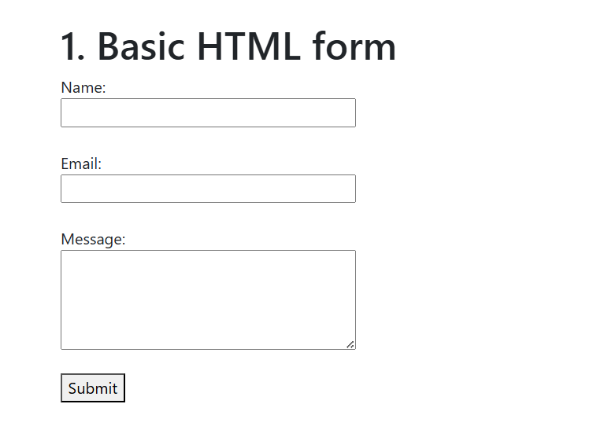
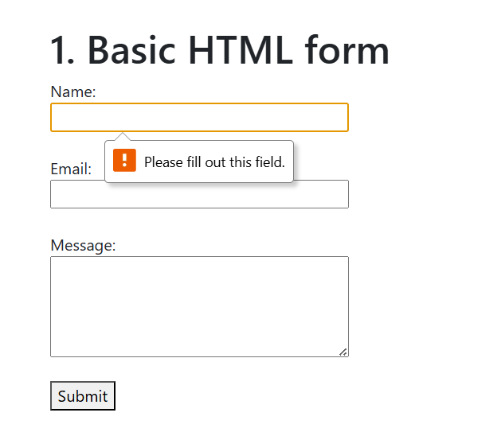
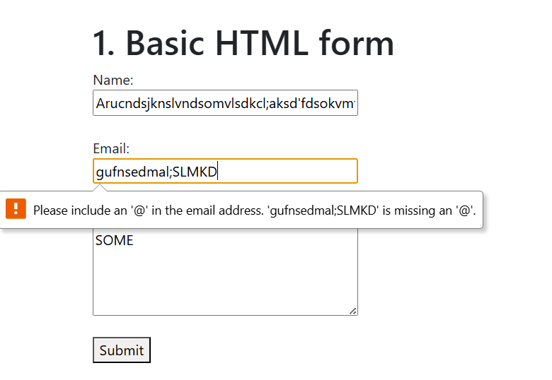
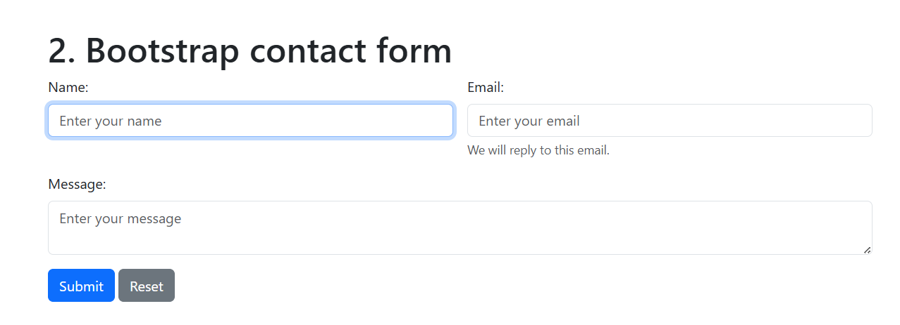
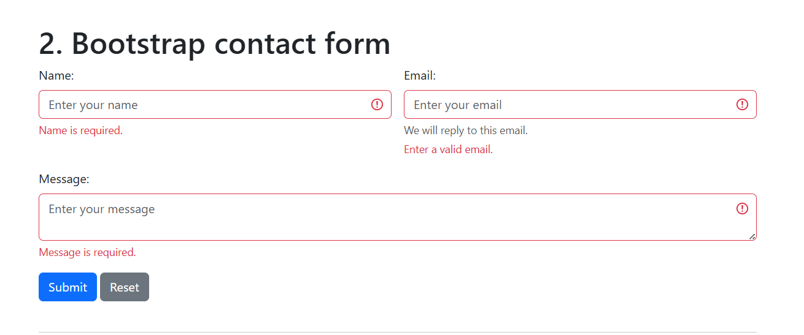
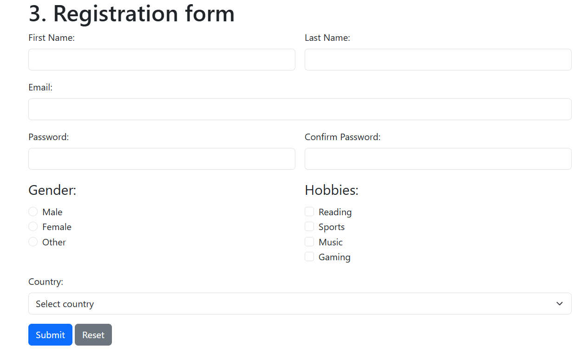
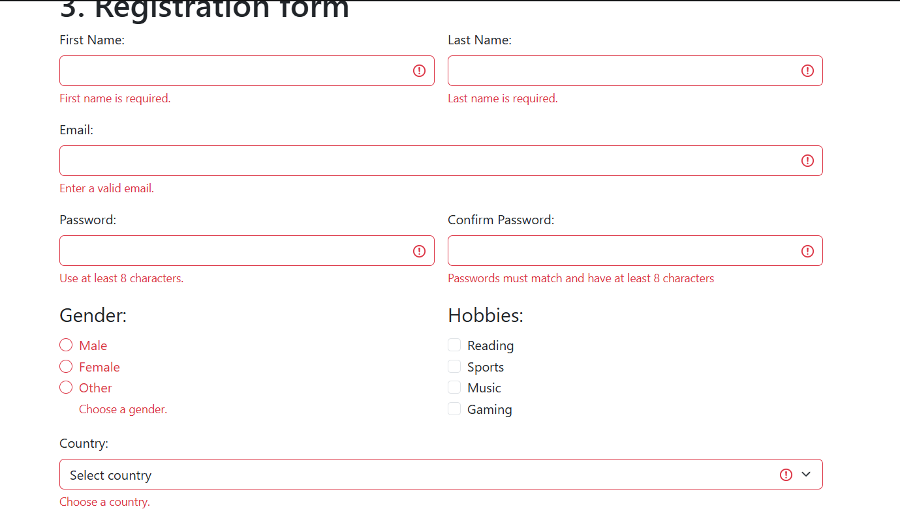

# Assignment 4

Aruzhan Abdrakhmanova IT-2501 
**Site:**  https://arabdrakh.github.io/front4/#all

#### Task 0. Simple Contact Form
Created a basic contact form with Name, Email, and Message fields, along with a Submit button

#### Task 1. Form with HTML5 Validation
Added built-in HTML5 validation attributes (required, type="email", and maxlength). Tested browser enforcement for empty inputs and invalid email formats without using js

#### Task 2. Bootstrap Form Styling
Recreated the contact form using Bootstrap 5 classes (form-control, form-label, form-text). Arranged the inputs into a responsive layout using the Bootstrap Grid system (row g-3, col-md-6).

#### Task 3. Registration Form
Created a responsive registration form with first and last names, email, password, confirm password, gender radio buttons, hobbies checkboxes, country select, and action buttons. Implemented HTML5 constraints (minlength="8") and custom JavaScript validation to verify that passwords match.

