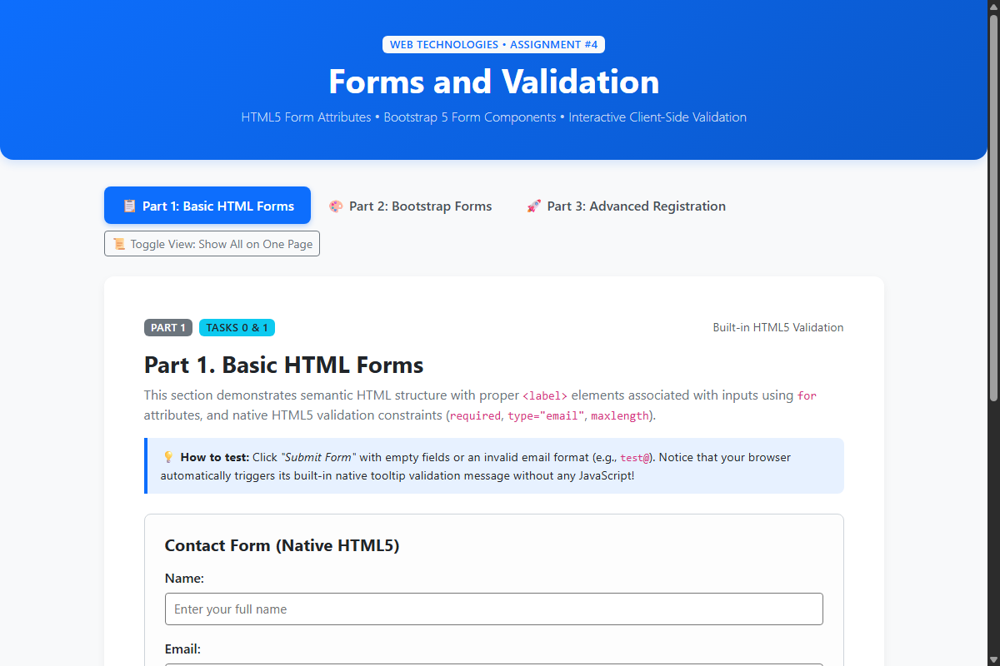
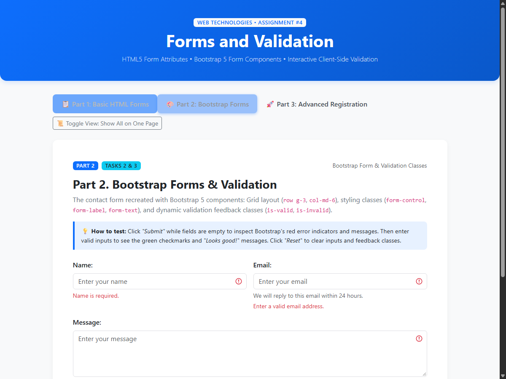
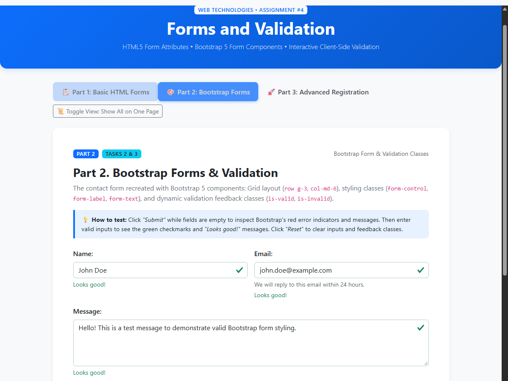
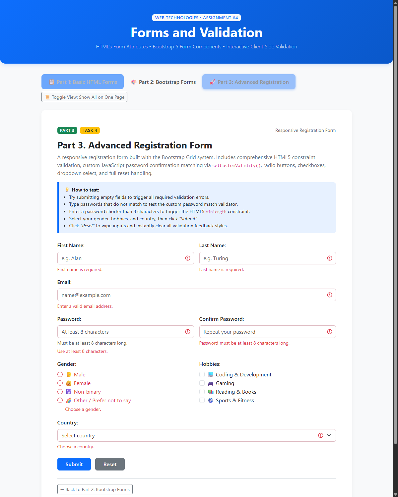
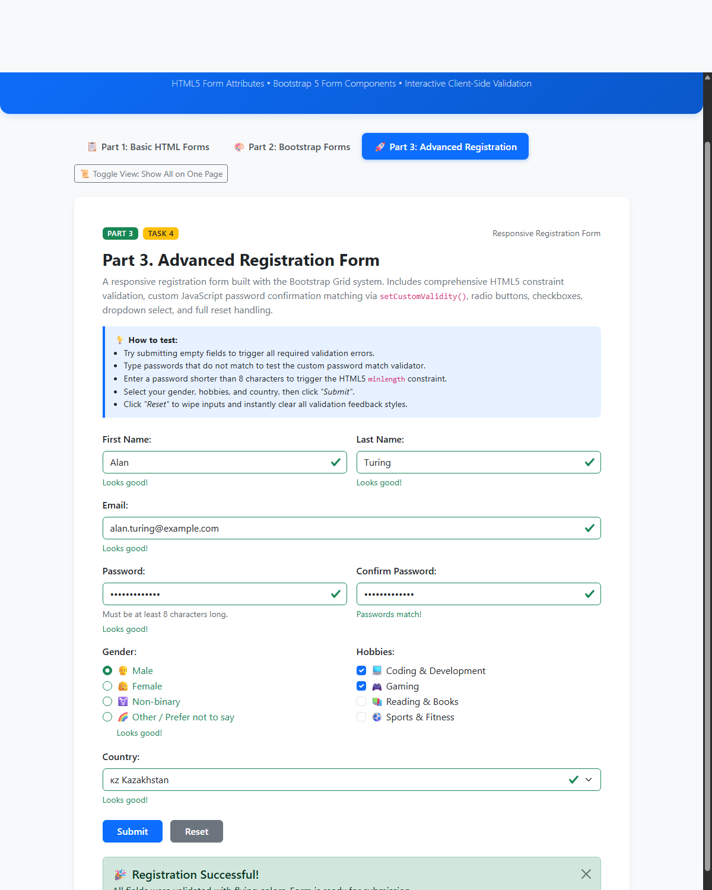
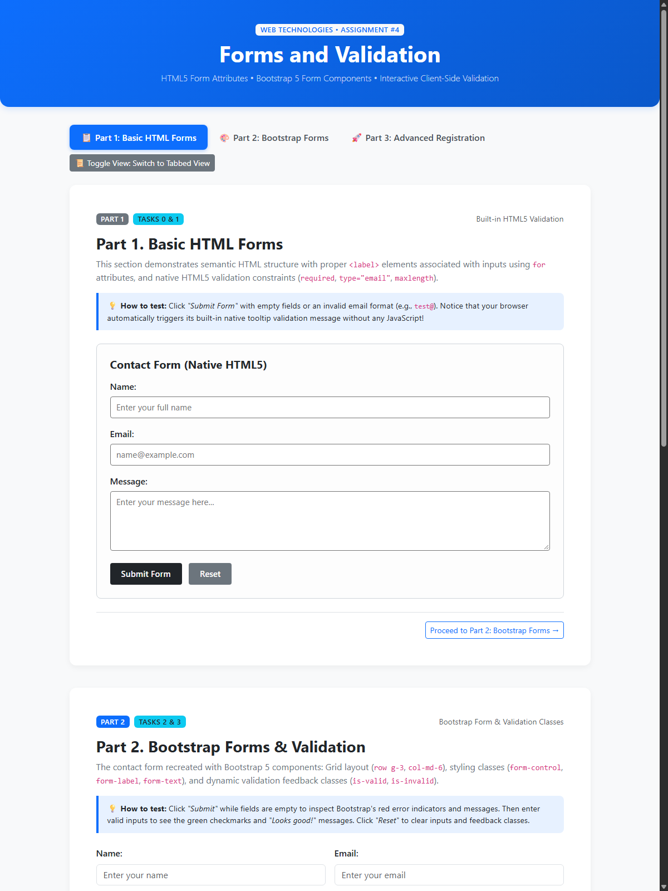

# Assignment #4. Forms and Validation

**Course:** Web Technologies (Front-End Development)  
**Student Name:** [Your Name / Имя Фамилия]  
**Group:** [Your Group / Ваша Группа, e.g., SE-2301]  
**Repository:** [Link to your GitHub repository]

---

## 📌 Project Overview & Objective

The objective of this assignment is to master the construction of user-friendly web forms using modern HTML5, style them with Bootstrap 5 components and the responsive Grid system, and implement comprehensive client-side form validation using both built-in HTML5 constraint attributes and Bootstrap validation feedback classes.

All tasks are unified in a single, high-performance, and responsive **`index.html`** file featuring:
- Seamless tab-based navigation across all 3 parts
- A single-page view switcher toggle (`Show All on One Page`)
- Direct URL hash routing (`#part1`, `#part2`, `#part3`, `#all`)
- Zero external build dependencies (runs immediately in any modern web browser via CDN)

---

## 🚀 How to Run the Project

1. Clone or download this repository:
   ```bash
   git clone <your-repository-url>
   cd front4
   ```
2. Open `index.html` directly in any web browser (Google Chrome, Microsoft Edge, Firefox, Safari):
   - Double-click `index.html`, OR
   - Right-click and choose **"Open with..."**, OR
   - Run a lightweight live server (e.g. VS Code Live Server extension).

---

## 📑 Assignment Tasks & Implementation Report

---

### Part 1. Basic HTML Forms

#### Task 0. Simple Contact Form
- **Objective:** Create a standard HTML contact form with fields for Name, Email, Message, and a Submit button.
- **Key Implementation Details:**
  - Semantic HTML structure using `<form>`, `<label>`, `<input>`, `<textarea>`, and `<button>`.
  - Every form input is strictly associated with a `<label>` element using matching `for` and `id` attributes for complete accessibility and browser support.
  - Proper attributes: `type="text"`, `type="email"`, `rows="4"`.

#### Task 1. Form with HTML5 Validation
- **Objective:** Add built-in HTML5 constraint validation attributes and test native browser enforcement.
- **Key Implementation Details:**
  - `required` attribute applied to all mandatory fields (Name, Email, Message).
  - `type="email"` enforces valid email syntax according to the browser's regex specification.
  - `maxlength="50"` on the name input and `maxlength="500"` on the message textarea prevent overflowing inputs.
  - **Native Browser Validation:** The `<form>` intentionally omits the `novalidate` attribute, enabling the browser's built-in validation tooltips (e.g. *"Please fill out this field"*, *"Please enter an email address"*) when attempting to submit invalid data.

#### Screenshot — Part 1: Basic HTML Contact Form


---

### Part 2. Bootstrap Forms

#### Task 2. Bootstrap Form Styling
- **Objective:** Recreate the contact form utilizing Bootstrap 5 form classes and grid layout.
- **Key Implementation Details:**
  - Built with the responsive Bootstrap Grid system: `<form class="row g-3">` with columns `<div class="col-md-6">` for Name and Email (side-by-side on desktop, stacked on mobile) and `<div class="col-12">` for Message.
  - Form controls styled via `.form-control` and `.form-label`.
  - Helpful descriptive subtext added with `<div class="form-text">We will reply to this email within 24 hours.</div>`.
  - Clear user-friendly placeholders on all fields.

#### Task 3. Bootstrap Validation Styles
- **Objective:** Apply Bootstrap validation feedback styles (`is-valid`, `is-invalid`) and display feedback messages below inputs.
- **Key Implementation Details:**
  - Added `novalidate` attribute to the form to suppress default browser popups and allow custom Bootstrap styling.
  - Feedback elements provided below each input:
    - `<div class="valid-feedback">Looks good!</div>`
    - `<div class="invalid-feedback">Name is required. / Enter a valid email address. / Message is required.</div>`
  - JavaScript submit listener uses the HTML5 Constraint Validation API method `field.checkValidity()` to dynamically toggle `.is-valid` and `.is-invalid` classes.
  - Includes a **Reset** button that clears inputs and immediately removes all validation feedback classes.

#### Screenshots — Part 2: Bootstrap Forms & Validation

##### 1. Invalid State (Validation Errors Triggered):


##### 2. Valid State (Successful Validation):


---

### Part 3. Advanced Form Project

#### Task 4. Registration Form
- **Objective:** Construct a complete, responsive user registration form with comprehensive validation.
- **Form Fields & Structure:**
  1. **First Name & Last Name:** Text inputs (`col-md-6`), `required`.
  2. **Email:** Email input (`col-12`), `required`.
  3. **Password:** Password input (`col-md-6`), `minlength="8"`, `required`.
  4. **Confirm Password:** Password input (`col-md-6`), `minlength="8"`, `required`.
  5. **Gender:** Radio buttons inside a semantic `<fieldset>` with `<legend>` (Male, Female, Non-binary, Other / Prefer not to say), `name="gender"`, `required`.
  6. **Hobbies:** Checkboxes inside a semantic `<fieldset>` with `<legend>` (Coding, Gaming, Reading, Sports).
  7. **Country:** Select dropdown (`col-12`), default empty option `"Select country"`, `required`.
  8. **Action Buttons:** Submit button (`btn btn-primary`) and Reset button (`btn btn-secondary`).

- **Advanced Validation Logic:**
  - **Password Confirmation Matching:** Validated dynamically using JavaScript's native Constraint Validation API:
    ```javascript
    if (passwordInput.value.length < 8) {
        confirmPasswordInput.setCustomValidity("Password must be at least 8 characters");
    } else if (confirmPasswordInput.value !== passwordInput.value) {
        confirmPasswordInput.setCustomValidity("Passwords do not match");
    } else {
        confirmPasswordInput.setCustomValidity("");
    }
    ```
  - **Real-time Live Validation:** Typing into `password` or `confirm` automatically re-evaluates the custom validity and updates the feedback message in real time.
  - **Radio Group Validation:** Selecting any gender option automatically clears error states across the radio group.
  - **Reset Handler:** Clears all input values, removes custom validity strings, hides success alerts, and clears `.is-valid` and `.is-invalid` CSS classes.

#### Screenshots — Part 3: Advanced Registration Form

##### 1. Invalid State (Required Fields & Password Constraints):


##### 2. Valid State (Complete Registration with Success Alert):


---

### 🌐 All Forms Single Page Overview

The application includes a view toggle (`Show All on One Page` / `Switch to Tabbed View`) allowing all forms to be displayed simultaneously for quick inspection:



---

## 🛠️ Summary of Work Process

1. **Architecture & Single File Design:**
   - Designed a single `index.html` structure organized with Bootstrap 5 tabs and a view switcher to ensure all assignment tasks are accessible in one cohesive document without breaking tasks into disjointed files.
2. **Implementing Part 1 (Tasks 0 & 1):**
   - Crafted pure semantic HTML with proper `<label for="...">` associations.
   - Verified that native HTML5 constraints (`required`, `type="email"`, `maxlength`) trigger built-in browser validation popups without interference from JavaScript.
3. **Implementing Part 2 (Tasks 2 & 3):**
   - Refactored the contact form with Bootstrap grid classes (`row g-3`, `col-md-6`, `col-12`), form controls, and helper text.
   - Implemented dynamic JavaScript validation that queries `checkValidity()` on inputs and toggles Bootstrap's `.is-valid` and `.is-invalid` classes.
4. **Implementing Part 3 (Task 4):**
   - Built a responsive registration layout with fields for personal information, credentials, radio buttons, checkboxes, and select dropdowns.
   - Engineered custom password matching logic with `setCustomValidity()`, live input listeners, and complete reset handlers.
5. **Testing and Verification:**
   - Thoroughly tested edge cases: empty submits, invalid emails, passwords shorter than 8 characters, password mismatches, and form resets.
   - Generated high-resolution visual proof screenshots and organized the project repository for clean presentation.

---

## 🎓 Defense & Practice Lesson Preparation (Cheat Sheet)

### 1. Key Technical Concepts & Q&A
* **Q: What is the purpose of the `novalidate` attribute on `<form>`?**  
  *A:* It disables the browser's default HTML5 validation tooltip bubbles, allowing developers to handle validation via JavaScript and display custom styled feedback (such as Bootstrap's `.valid-feedback` and `.invalid-feedback`).

* **Q: How does `checkValidity()` work in JavaScript?**  
  *A:* `element.checkValidity()` is part of the HTML5 Constraint Validation API. It evaluates whether an element satisfies its HTML validation constraints (`required`, `minlength`, `type`, `pattern`, etc.) and returns `true` or `false`.

* **Q: How does `setCustomValidity(message)` work?**  
  *A:* When passed a non-empty string, it marks the field as invalid and sets `field.validity.customError` to `true`. When passed an empty string `""`, it clears the custom error and restores standard constraint validation.

* **Q: Why are `<label>` `for` attributes important?**  
  *A:* They bind the label to the input with the corresponding `id`. This improves usability (clicking the label focuses/activates the input) and makes the form accessible to screen readers and assistive technologies.

### 2. Common Live Coding Defense Tasks
* **Add a Phone Number field with validation:**
  ```html
  <div class="col-md-6">
      <label for="phone" class="form-label">Phone Number:</label>
      <input type="tel" class="form-control" id="phone" pattern="[0-9]{10,12}" placeholder="77011234567" required>
      <div class="invalid-feedback">Enter a valid phone number (10-12 digits).</div>
  </div>
  ```
* **Add a "Terms & Conditions" checkbox:**
  ```html
  <div class="col-12">
      <div class="form-check">
          <input type="checkbox" class="form-check-input" id="terms" required>
          <label for="terms" class="form-check-label">I agree to terms and conditions</label>
          <div class="invalid-feedback">You must agree before submitting.</div>
      </div>
  </div>
  ```
